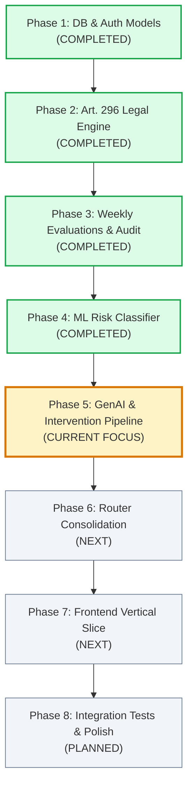
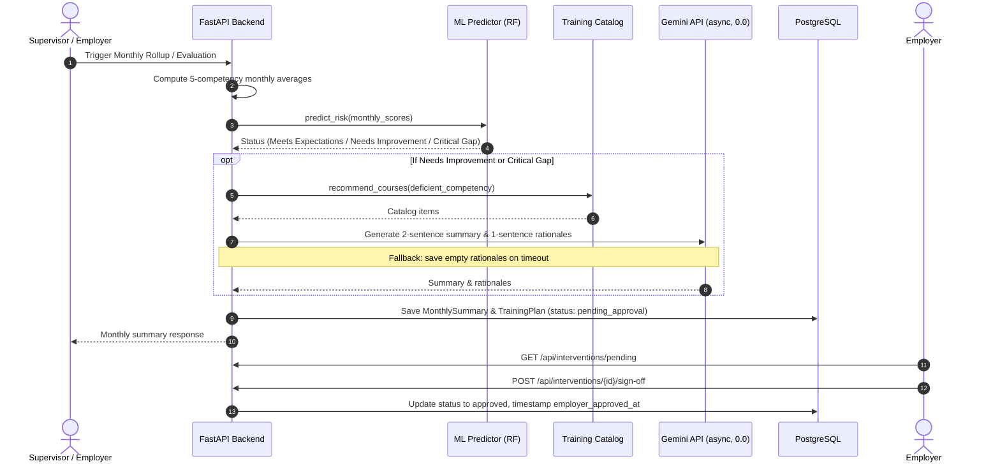

# Performa Project Roadmap & Current Progress

> **Architecture Reference**: [ARCHITECTURE.md](file:///d:/projects/performa/ARCHITECTURE.md)  
> **Status Overview**: Backend Core (DB, Auth, Article 296, Weekly Evaluations, ML Engine) is ~85% complete. Next up is Phase 5 (GenAI & Intervention Pipeline), followed by Phase 6 (Router Consolidation) and Phase 7 (Frontend Vertical Slice).

---

---

## Detailed Phase Breakdown

### Phase 1: Database & Multi-Tenant Core
**Status: COMPLETED (100%)**
- [x] Asynchronous PostgreSQL connection via SQLAlchemy 2.0 + asyncpg (`backend/database.py`).
- [x] Complete relational ORM schema (`backend/models.py`):
  - `Organization`, `User`, `ProbationaryEmployee`, `WeeklyEvaluation`, `MonthlySummary`, `TrainingPlan`, `EvaluationAuditLog`.
- [x] Strict tenant isolation enforced by `organization_id` on all entities.
- [x] Pydantic v2 schemas for all payload validation and JSON responses (`backend/schemas.py`).
- [x] JWT Bearer authentication and password hashing with bcrypt (`backend/auth.py`).
- [x] Database seed script with deterministic baseline data (`backend/seed.py`).

---

### Phase 2: Philippine Labor Code (Article 296) Legal Engine
**Status: COMPLETED (100%)**
- [x] Strict 180-day timeline calculation bounded in `Asia/Manila` timezone (`backend/routers/employees.py`).
- [x] Automated milestone alerts triggered at Day 150, Day 165, and Day 178 (`/api/employees/milestones`).
- [x] Restricted to strictly 5 statutory competencies:
  1. `task_completion`
  2. `attendance_and_punctuality` (evaluator rating score only; no biometric punch clocks or leave requests)
  3. `communication_and_teamwork`
  4. `initiative_and_adaptability`
  5. `quality_of_work`
- [x] Employee profile management, standards acknowledgement tracking, and status transitions.

---

### Phase 3: Weekly Evaluations & Immutable Audit Trail
**Status: COMPLETED (100%)**
- [x] Weekly evaluation submission endpoint (`POST /api/evaluations/{employee_id}/weekly` in `backend/routers/evaluations.py`).
- [x] Role restrictions: rating submissions limited to `employer` and `supervisor`.
- [x] Live competency scorecard and gap calculation against 4.0 benchmark (`GET /api/evaluations/{employee_id}/scorecard`).
- [x] Append-only, immutable audit trail logging any score change with prior/new score, evaluator ID, and timestamp (`GET /api/evaluations/{employee_id}/audit-trail`).

---

### Phase 4: Machine Learning Subsystem
**Status: COMPLETED (100%)**
- [x] Standardized `COMPETENCIES` tuple ordering (`backend/ml/catalog.py`).
- [x] Synthetic dataset generator (600 rows, stratified 80/20, seed 42) bounded to `[1.0, 5.0]` (`backend/ml/train.py`).
- [x] Airtight deterministic labeling priority cascade:
  - *Critical Gap*: Overall mean < 2.5 OR min(quality, task) < 2.0
  - *Needs Improvement*: Overall mean < 3.5 OR min(score) < 3.0 OR std_dev > 1.0
  - *Meets Expectations*: All other passing distributions
- [x] Model trained with `RandomForestClassifier(n_estimators=100, max_depth=6)` and saved to `backend/ml/models/rf_model.joblib` (97.5% test accuracy).
- [x] In-memory inference service `predict_employee_risk(scores)` in `backend/ml/predictor.py` returning:
  - `predicted_tier` (Meets Expectations, Needs Improvement, Critical Gap)
  - `confidence` (4 decimal places)
  - `probabilities` (distribution across all 3 classes)
  - `flagged_competencies` (scores < 3.0 in canonical order)
- [x] Course catalog access module `get_catalog()` and `recommend_courses(competency)` in `backend/ml/catalog.py`.
- [x] Removed empty `backend/ml.py` stub in favor of modular `backend/ml/` package.
- [x] *Pre-Phase 5 Alignment*: Reconciled `backend/ml/training_catalog.json` fields with `TrainingPlan` non-null columns (`catalog_id`, `intervention_type`, `default_timeline`, `intervention_title`) and removed duplicate root file.

---

### Phase 5: GenAI & Intervention Pipeline
**Status: COMPLETED (100%)**

#### Action Items for Phase 5:
- [x] **Implement `backend/gemini.py`**:
  - Async Google Gemini client with strict `temperature=0.0`.
  - Configured with `gemini-3.5-flash-lite` (primary) and `gemini-flash-latest` (fallback).
  - Prompt generating a 2-sentence performance summary and 1-sentence rationale per recommended intervention.
  - Robust timeout handler (10s) and fallback returning empty rationales without failing the request.
- [x] **Build Rollup & Intervention Generation Logic** (`backend/routers/interventions.py`):
  - `POST /api/interventions/{employee_id}/monthly-rollup?month_number={N}`
  - Calculates 5-competency monthly averages from `WeeklyEvaluation` rows.
  - Invokes `predict_employee_risk(competency_scores)`.
  - Invokes `recommend_courses()` for flagged competencies.
  - Invokes `generate_performance_rationales(...)`.
  - Persists `MonthlySummary` and `TrainingPlan` rows with `status = "pending_approval"`.
- [x] **Build Employer Sign-off Endpoints**:
  - `GET /api/interventions/pending` (tenant-scoped, joins `ProbationaryEmployee`).
  - `POST /api/interventions/{plan_id}/sign-off` (supports `approved: true/false`, timestamps `employer_approved_at`).
- [x] **Registered in `backend/main.py`**: Mounted cleanly under `/api/interventions`.

---

### Phase 6: Router Consolidation & Code Hygiene
**Status: COMPLETED (100%)**
- [x] Removed unused 0-byte router stubs (`backend/routers/admin.py`, `employer.py`, `employee.py`, `supervisor.py`).
  - Core routes are cleanly consolidated into 4 resource-based modules: `auth.py`, `employees.py`, `evaluations.py`, and `interventions.py`.
- [x] Cleaned up unused empty files (`backend/deps.py`, `backend/security.py`).
- [x] Locked down `backend/requirements.txt` with exact production dependencies (FastAPI, SQLAlchemy, asyncpg, scikit-learn, google-genai, etc.).
- [x] Verified clean application startup with 0 dangling imports or 0-byte files in `backend/`.

---

### Phase 7: Frontend SPA - Design System & Full UI Implementation
**Status: PENDING (Specification & Prototype Ready)**

> **Design Specification Reference**: Extracted from `reference/performa-redesign-preview.html` and `HANDOFF_PROMPT.md`.
> **Design Philosophy**: High-polish, editorial-grade UI for Philippine SMEs. 100% real data from FastAPI endpoints; no dummy prototype strings in production.

#### 1. Design System & Tokens
- **Palettes**: 5 harmonized semantic palettes switched via `<html data-theme="...">` (system auto-detects `paper` for light, `midnight` for dark):
  - `paper`: Warm editorial default light (`--bg: #f6f3ed`, `--accent: #b94b21`)
  - `midnight`: Obsidian slate default dark (`--bg: #090b10`, `--accent: #3b82f6`)
  - `dusk`: Deep cosmic violet (`--bg: #0c0a14`, `--accent: #9368f7`)
  - `mist`: Scandinavian technical slate (`--bg: #f0f4f8`, `--accent: #0274af`)
  - `sage`: Organic spruce green (`--bg: #edf2ee`, `--accent: #0f766e`)
- **Typography**: Strictly self-hosted `Geist` (UI text) and `Geist Mono` (tabular numbers, dates, scores, IDs, SHA-256 hashes).
- **Icons**: Strictly `lucide-react` (matching prototype glyphs).
- **Tokens**: Spacing (`--s1` to `--s7`), radii (`--r-ctl: 6px`, `--r-field: 10px`, `--r-nav: 10px`, `--r-float: 14px`), transitions (`--m: 160ms`, `--ease`).

#### 2. Shell & Responsive Layout (`<= 820px` break)
- **Desktop Shell**: Sticky sidebar (`248px` expanded, `72px` collapsed via `[` key), brand header, section dividers, active page highlights with badge counters, footer with avatar, theme toggle, and sign out.
- **Mobile Shell**: Sticky glassmorphic app bar (`52px` + safe-area) with back navigation in detail views + fixed 5-tab bottom bar (`Dashboard`, `Employees`, `KPIs`, `Plans`, `Reports`).
- **Command Palette (`Ctrl+K` / `⌘K`)**: Fast search across pages, employees, and quick actions.

#### 3. Phased Implementation Roadmap
- [ ] **Phase 7A: Foundations & Audit**:
  - API client (Axios/Fetch wrapper) with JWT header attachment, auto-logout on 401, and FastAPI 422 error normalization.
  - TanStack Query defaults (query-key factory, `staleTime`, no retry on 4xx, error boundaries).
  - Router setup (React Router 6) with AuthGuard, RoleGuard (`403`), and `404` handling.
  - Shared date & time utility locked strictly to `Asia/Manila` (never using client browser clock for day math).
- [ ] **Phase 7B: Design System Integration**:
  - Create `frontend/src/tokens.css` with exact variables and palette definitions.
  - Configure `tailwind.config.js` to map colors and radii directly to CSS variables (no hardcoded hex).
  - Install and self-host `Geist` and `Geist Mono` via `@fontsource/geist-sans` and `@fontsource/geist-mono`.
  - Create `ThemeProvider` supporting Light/Dark/System + 5 palettes, with an inline pre-paint script in `index.html` to eliminate theme flash.
- [x] **Phase 7C: Core UI Primitives (`src/components/ui/`)**:
  - `Button` (primary, secondary, subtle, ghost, danger, with loading spinner and icon slots)
  - `Badge` (subtle semi-transparent tints: neutral, accent, ok, warn, bad, hot)
  - `ScoreMeter` (proportional 5.0 bar with target tick mark `<u>` and bad/warn/ok color fill)
  - `StatusDot` (active, warning, critical, regularized, terminated with pulsing animations)
  - `MilestonePill` (Article 296 statutory milestone badges: Days 150/165/178 warnings)
  - `Skeleton` (smooth shimmer loading state using `bg-hover/80 animate-pulse`)
- [x] **Phase 7D: AppShell Component**:
  - Collapsible desktop sidebar with remembered state, brand logo, role navigation, and theme switcher.
  - Mobile top header with contextual back title + theme pill + avatar.
  - Mobile bottom navigation with quick-touch role tabs.
  - Global Command Palette (`Ctrl+K` / `⌘K`) for rapid navigation and palette switching.
  - Role-aware navigation configs (`employer`, `supervisor`, `probationary_employee`, `admin`).
- [ ] **Phase 7E: Page-by-Page Migration (Employer first, then Supervisor & Employee)**:
  1. `Settings`: Profile details, Appearance (mode & 5 palettes), Security (password update), and Milestone Alerts toggle.
  2. `Employees`: Master directory, tabs (`All`, `Probationary`, `Regular`), filters (department, performance), sorting, and search.
  3. `Employee Detail`: Individual employee profile, details dl list, account status with deactivate modal, quick action buttons.
  4. `Add Employee`: Modal/form with validation, role selection, department datalist, and temp password notice.
  5. `Rate Employee`: Weekly scoring matrix for the 5 competencies, target 4.0 marker, remarks, and append-only audit trail confirmation dialog.
  6. `Dashboard`: Probation overview, 180-day progress timeline bar with Day 150/165/178 ticks, active probationers table, and AI intervention suggestions list.
  7. `KPIs / Scorecard`: Employee scorecard, stats cards (Latest, Weighted target, Gap to target), 5 competency breakdown, sort by worst gap.
  8. `Review Plans`: Intervention approvals queue, 2-sentence AI summary, recommended courses checklist with rationales, and approve/reject actions.
  9. `Reports` & `Report View`: Performance report archives, report generation form, PDF export, and SHA-256 fingerprint copy.
- [ ] **Phase 7F: Frontend QA & Accessibility**:
  - Viewport verification at 375px (mobile), 768px (tablet), and 1280px (desktop).
  - All 5 theme palettes verified for AA contrast.
  - Keyboard-only navigation pass (`Tab`, `Enter`, `Esc`, `[`, `Ctrl+K`).
  - Zero prototype mock names/data remaining in production components.

---

### Phase 8: Testing, Verification & Hardening
**Status: PLANNED**
- [ ] Pytest suite covering auth, multi-tenant isolation, milestone math (Day 150/165/178), audit immutability, and ML predictor score bounds.
- [ ] Seed data validation and end-to-end user journey check.
