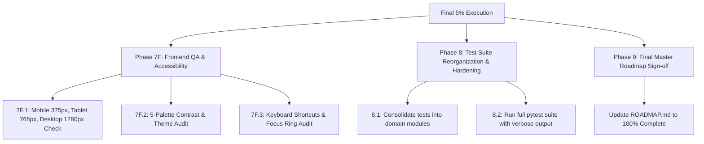

# Phase 7F & Phase 8 Final Execution Plan

## Goal Description
You are 100% right! While DeepSeek fixed the 16 core contract bugs and wrote 29 passing wave tests, **Phase 7F (Frontend QA & Accessibility Audit)** and **Phase 8 (Domain-Organized Pytest Suite & Final Hardening)** are still pending to reach 100% completion on [`ROADMAP.md`](file:///d:/projects/performa/ROADMAP.md).

This plan outlines the final 5% required to declare Performa production-ready and fully aligned with the capstone manuscript.

---

## User Review Required

> [!IMPORTANT]
> **Test Suite Reorganization (Phase 8):**
> DeepSeek organized its 29 tests into arbitrary "wave" files (`test_wave1_contracts.py`, `test_wave2_authz.py`, `test_wave3_backend.py`, `test_wave5_features.py`). We will reorganize these into clean, domain-based test modules matching `ROADMAP.md`:
> - `test_auth.py`
> - `test_admin.py`
> - `test_milestones.py`
> - `test_evaluations.py`
> - `test_interventions_and_ml.py`
> All 29+ test cases will be preserved and enhanced.

> [!NOTE]
> **Live Browser QA (Phase 7F):**
> We will use our built-in browser subagent to test real viewports (Mobile 375px, Tablet 768px, Desktop 1280px) and verify keyboard navigation (`Ctrl+K`, `[`, `Esc`, `Tab`) and theme contrast across all 5 palettes.

---

## Proposed Execution Workflow



---

## Detailed Implementation Steps

### Component 1: Phase 7F — Frontend QA & Accessibility Pass

#### 1. Viewport Responsiveness Audit
* **Mobile (375px $\times$ 667px — iPhone SE):**
  - Verify `MobileBar` renders cleanly at the top with logo, status badge, and avatar.
  - Verify `BottomTabBar` renders cleanly at the bottom without overlapping content or hiding buttons.
  - Verify tables in `Employees.jsx`, `UserManagement.jsx`, and `AuditTrail.jsx` have horizontal swipe (`overflow-x-auto`) and don't blow out viewport width.
  - Verify modals (`AddEmployeeModal`, `StatusTransitionModal`) fit within the 375px screen with scrollable bodies.
* **Tablet (768px $\times$ 1024px — iPad):**
  - Verify grid layouts collapse from 4-columns to 2-columns gracefully.
  - Verify sidebar collapse/expand toggle works smoothly.
* **Desktop (1280px $\times$ 800px):**
  - Verify max-width container constraints (`max-w-7xl mx-auto`) and whitespace balance.

#### 2. Theme & Contrast Audit (5 Palettes)
* Cycle through all 5 palettes via `Ctrl+K` or Settings:
  - `paper` (Default Light — warm editorial)
  - `midnight` (Default Dark — obsidian slate)
  - `dusk` (Deep evening indigo)
  - `mist` (Cool executive gray)
  - `sage` (Calm muted olive)
* Verify that text labels (`text-ink`, `text-ink-2`, `text-ink-3`) maintain WCAG AA contrast against `var(--bg)` and `var(--surface)`.
* Verify badge colors (`bg-ok/15 text-ok`, `bg-warn/15 text-warn`, `bg-bad/15 text-bad`, `bg-accent/15 text-accent`) remain readable in all 5 themes.

#### 3. Keyboard Navigation & Accessibility Audit
* Verify `Ctrl+K` (or `Cmd+K`) opens the Command Palette from anywhere in the app.
* Verify `[` toggles the Sidebar between collapsed (72px) and expanded (250px).
* Verify `Esc` closes any active modal or command palette.
* Verify `Tab` moves through interactive form inputs with clear `outline: 2px solid var(--accent)` `:focus-visible` rings.

---

### Component 2: Phase 8 — Pytest Suite Reorganization & Hardening

#### [NEW / REORGANIZE] Clean Domain Test Modules
Replace the temporary wave test files with clean, permanent test suites in [`backend/tests/`](file:///d:/projects/performa/backend/tests):

1. **`test_auth.py`**:
   - Form-based login with OAuth2 form data
   - JWT token issuance & expiration
   - Cookie authentication + header fallback
   - Login rate-limiting (5 failures in 5 minutes $\rightarrow$ 429)
   - Profile retrieval (`GET /api/auth/me`) and self-update (`PATCH /api/auth/me`)
   - Password change (`POST /api/auth/change-password`)
2. **`test_admin.py`**:
   - List tenant users (`GET /api/admin/users`) with role filtering
   - Create user account with role selection (`POST /api/admin/users`)
   - Toggle user activation (`PATCH /api/admin/users/{id}/status`)
   - Reset user password (`POST /api/admin/users/{id}/reset-password`)
   - Activity log retrieval (`GET /api/admin/activity`)
3. **`test_milestones.py`**:
   - Article 296 Day 150 (Performance Review), Day 165 (Intervention Sign-off), Day 178 (Notice Period), Day 180 (Regularization Deadline)
   - Date calculations strictly in `Asia/Manila` timezone
   - Overdue flag calculation
4. **`test_evaluations.py`**:
   - Supervisor weekly rating submission (1.0–5.0 scale across 5 competencies)
   - Scorecard competency array calculation & 4.0 regularizing gap math
   - Append-only immutable audit trail recording
   - Supervisor assignment scoping (Supervisor Juan can only evaluate assigned employees)
5. **`test_interventions_and_ml.py`**:
   - Monthly summary generation & rollup idempotency
   - Random Forest risk tier output bounds (nominal, low, medium, high)
   - Feature importances explainability
   - Gemini training plan fallback rationale
   - Employer digital sign-off (`POST /api/interventions/{plan_id}/sign-off`)
   - Employee training view scoping (`GET /api/interventions/mine`)

---

### Component 3: Phase 9 — Final Roadmap & Master Status Sign-Off

#### [MODIFY] [`ROADMAP.md`](file:///d:/projects/performa/ROADMAP.md)
* Check off all items in Phase 7F and Phase 8.
* Update overall project status to **100% COMPLETE**.

---

## Verification Plan

### Automated Tests
```bash
# Run the reorganized domain pytest suite
python -m pytest -v

# Run the frontend production build
cd frontend && npm run build
```

### Manual Browser Verification
1. Run browser subagent at `375px` to record mobile experience.
2. Run browser subagent at `1280px` to verify theme switching across all 5 palettes.
3. Verify live navigation across all 4 seeded roles (`Admin`, `Employer`, `Supervisor`, `Employee`).
