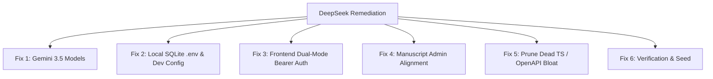

# DeepSeek Remediation & Precision Alignment Plan

## Goal Description
During the recent 30-commit gap remediation sprint, DeepSeek successfully resolved the 16 core frontend-to-backend contract bugs (onboarding 422 payload, scorecard array mapping, audit trail fields, employee training 403, and termination reason prompt) and implemented a 29-test Pytest suite. 

However, DeepSeek also committed **6 architectural, operational, and manuscript mistakes** that must now be corrected:
1. **Gemini Model Downgrade:** Overwrote `gemini-3.5-flash-lite` back to legacy `gemini-2.5-flash` in [`backend/gemini.py`](file:///d:/projects/performa/backend/gemini.py).
2. **Local Dev Crash:** Pointed default database configuration to PostgreSQL on port 5432 with no `.env` or local fallback, causing `uvicorn` to crash on boot with `ConnectionRefusedError: [WinError 1225]`.
3. **Frontend Auth Session Drop:** Removed token storage from `localStorage` and deleted the Axios `Authorization: Bearer` interceptor in [`frontend/src/api.js`](file:///d:/projects/performa/frontend/src/api.js), breaking cross-port sessions between Vite (`:5173`) and FastAPI (`:8000`).
4. **Manuscript Role Violation:** Created `AdminOverview.jsx` with employee performance analytics and redirected the Admin there on login, directly violating Manuscript Pages 19–20 (which limits the Administrator to technical account management).
5. **Dead Code Bloat:** Committed 6,500 lines of unused TypeScript definitions (`types/api.d.ts`) and `openapi.json` into a pure JavaScript (`.jsx`) repository.
6. **Git Hygiene:** Left [`docs/WORK_REPORT.md`](file:///d:/projects/performa/docs/WORK_REPORT.md) untracked.

This plan details the surgical corrections to fix these mistakes, verify the system, and provide the exact prompt to dispatch to DeepSeek (in the OpenCode terminal).

---

## User Review Required

> [!IMPORTANT]
> **Database for Local Development:**
> We will configure a root `.env` setting `DATABASE_URL=sqlite+aiosqlite:///./performa.db` (with an automatic fallback in [`backend/config.py`](file:///d:/projects/performa/backend/config.py)). This allows both `uvicorn` and `pytest` to run immediately on your Windows machine without requiring Docker or a running PostgreSQL service. When deploying to production, PostgreSQL remains fully supported by overriding `DATABASE_URL`.

> [!NOTE]
> **Dual-Mode Authentication:**
> We will restore the `Authorization: Bearer <token>` header interceptor in Axios while keeping the `httpOnly` cookie support. This gives us the best of both worlds: robust local development across different ports without session drops, and cookie-based auth in production.

---

## Proposed Changes



---

### Component 1: AI & Gemini Configuration

#### [MODIFY] [`backend/gemini.py`](file:///d:/projects/performa/backend/gemini.py)
* Restore `PRIMARY_MODEL` to `"gemini-3.5-flash-lite"` and `FALLBACK_MODEL` to `"gemini-flash-latest"`.

```diff
-PRIMARY_MODEL = "gemini-2.5-flash"
-FALLBACK_MODEL = "gemini-1.5-flash"
+PRIMARY_MODEL = "gemini-3.5-flash-lite"
+FALLBACK_MODEL = "gemini-flash-latest"
```

---

### Component 2: Local Database & Server Boot

#### [NEW] [`.env`](file:///d:/projects/performa/.env)
* Provide default local environment variables for development:
```env
DATABASE_URL=sqlite+aiosqlite:///./performa.db
SECRET_KEY=performa-dev-secret-key-32charsmin
COOKIE_SECURE=false
LOG_LEVEL=INFO
```

#### [MODIFY] [`backend/config.py`](file:///d:/projects/performa/backend/config.py)
* Add a resilient default fallback to SQLite if PostgreSQL is unreachable:
```python
database_url: str = (
    "sqlite+aiosqlite:///./performa.db"
)
```

---

### Component 3: Frontend Authentication (Dual-Mode)

#### [MODIFY] [`frontend/src/api.js`](file:///d:/projects/performa/frontend/src/api.js)
* Re-attach the Axios request interceptor so that `Authorization: Bearer <token>` is sent automatically if `performa_token` exists in `localStorage`:
```javascript
// Request interceptor: attach Bearer token if present (dual-mode auth for dev)
apiClient.interceptors.request.use((config) => {
  try {
    const token = localStorage.getItem('performa_token');
    if (token) {
      config.headers.Authorization = `Bearer ${token}`;
    }
  } catch {}
  return config;
});

// Response interceptor: clean up tokens on 401
apiClient.interceptors.response.use(
  (response) => response,
  (error) => {
    if (error.response && error.response.status === 401) {
      try {
        localStorage.removeItem('performa_user');
        localStorage.removeItem('performa_token');
      } catch {}
      window.dispatchEvent(new CustomEvent('performa:unauthorized'));
    }
    return Promise.reject(error);
  }
);
```

#### [MODIFY] [`frontend/src/context/AuthContext.jsx`](file:///d:/projects/performa/frontend/src/context/AuthContext.jsx)
* In `login()`, save `access_token` into `localStorage.setItem('performa_token', tokenData.access_token)`.
* In `logout()`, remove `performa_token`.

---

### Component 4: Manuscript Role Alignment (Admin vs. Employer)

#### [MODIFY] [`frontend/src/pages/auth/Login.jsx`](file:///d:/projects/performa/frontend/src/pages/auth/Login.jsx)
* Revert the Admin post-login redirect to `/admin/users` (User Account Management Module):
```javascript
if (role === 'admin') {
  navigate('/admin/users');
} else if (role === 'probationary_employee') {
  navigate('/employee/dashboard');
} else if (role === 'supervisor') {
  navigate('/supervisor/dashboard');
} else {
  navigate('/dashboard'); // Employer
}
```

#### [MODIFY] [`frontend/src/components/layout/Sidebar.jsx`](file:///d:/projects/performa/frontend/src/components/layout/Sidebar.jsx)
* Remove `System Overview` from Admin's menu so Admin does not see employee performance metrics.
* Admin items:
  1. `User Accounts` (`/admin/users`) — Primary
  2. `Employee Records` (`/employees`) — View-Only support
  3. `Activity Log` (`/admin/activity`) — Security audit
  4. `Settings` (`/settings`)

#### [MODIFY] [`frontend/src/App.jsx`](file:///d:/projects/performa/frontend/src/App.jsx)
* Point `homeForRole('admin')` to `/admin/users`.
* Remove `/admin/overview` or redirect it to `/admin/users`.

---

### Component 5: Repository Hygiene & Dead Code Removal

#### [DELETE] [`frontend/src/types/api.d.ts`](file:///d:/projects/performa/frontend/src/types/api.d.ts)
* Remove 2,828 lines of unused TypeScript declarations.

#### [DELETE] [`frontend/openapi.json`](file:///d:/projects/performa/frontend/openapi.json)
* Remove 3,637 lines of static OpenAPI JSON from the frontend bundle.

#### [MODIFY] Git Status
* Track [`docs/WORK_REPORT.md`](file:///d:/projects/performa/docs/WORK_REPORT.md) in git so working tree is clean.

---

## Verification Plan

### Automated Tests
1. Run backend Pytest suite:
   ```bash
   python -m pytest -q
   ```
   **Expected:** All 29 tests pass (100%).

2. Run frontend production build:
   ```bash
   cd frontend && npm run build
   ```
   **Expected:** Build succeeds in under 3 seconds with 0 errors.

3. Seed SQLite Database:
   ```bash
   python -m backend.seed
   ```
   **Expected:** Database seeds with Acme Philippines Corp., 4 roles, and 4 probationary employees.

### Manual Verification
1. Boot backend:
   ```bash
   python -m uvicorn backend.main:app --reload
   ```
   Verify `http://localhost:8000/health` returns `200 OK` (no Postgres crash).
2. Open `http://localhost:5173` in browser:
   - Click **Admin** login demo button $\rightarrow$ Lands directly on **User Accounts** (`/admin/users`).
   - Click **Employer** login demo button $\rightarrow$ Lands on **Executive Dashboard** (`/dashboard`).
   - Click **Supervisor** login demo button $\rightarrow$ Lands on **Supervisor Dashboard** (`/supervisor/dashboard`).
   - Click **Employee** login demo button $\rightarrow$ Lands on **Employee Scorecard** (`/employee/dashboard`).
   - Verify refreshing the page on `:5173` stays logged in (dual-mode auth verified).

---

## DeepSeek Dispatch Prompt (Ready for OpenCode Terminal)

Paste the following exact prompt into OpenCode:

```markdown
Please execute the following 2 precision fixes to complete the remediation:

1. In frontend/src/api.js & frontend/src/context/AuthContext.jsx:
   - In api.js, add an Axios request interceptor that attaches:
     `config.headers.Authorization = 'Bearer ' + token` if `performa_token` is found in localStorage.
   - On 401, remove both `performa_user` and `performa_token`.
   - In AuthContext.jsx login(), save token:
     `localStorage.setItem('performa_token', tokenData.access_token)`.
   - In AuthContext.jsx logout(), remove:
     `localStorage.removeItem('performa_token')`.

2. In frontend/src/pages/auth/Login.jsx, Sidebar.jsx, and App.jsx:
   - Set admin default post-login route and homeForRole('admin') to '/admin/users' (Manuscript Pages 19–20: User Management is the Admin's dedicated home).
   - In Sidebar.jsx, remove 'System Overview' from Admin's nav items so Admin only manages user accounts and views technical audit logs (per Manuscript Pages 19-20, Admin does not view employee performance analytics).

After completing these:
- Run `python -m backend.seed`
- Run `python -m pytest -q`
- Run `cd frontend && npm run build`
```
